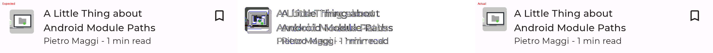

# JetNews: screenshot tests with Paparazzi

This repository is a take-home assignment for a QA Manager role. It adds visual regression tests to
Google's [JetNews](https://github.com/android/compose-samples/tree/main/JetNews) sample app.

The task asks for a sample app that mimics a news feed with a breaking-news banner and paywalled
items. JetNews has neither, so this fork adds them to the app itself (`app/src/main`), not to the
tests:

- `BreakingNewsBanner` at the top of the home feed (`ui/home/BreakingNewsBanner.kt`), fed by
  `PostsFeed.breakingNews`;
- a `PremiumBadge` on paywalled articles (`ui/home/PremiumBadge.kt`, `Post.isPremium`);
- a `dynamicColor` switch on `JetnewsTheme`, so tests can render the brand colors (see below).

The data still comes through the app's `PostsRepository` interface. The fake implementation returns
fixed data, which is the same seam a production app would use to inject fixtures.

The tests render the app's own Jetpack Compose UI on the JVM with
[Paparazzi](https://github.com/cashapp/paparazzi) and compare every image with an approved golden.
No device or emulator is needed.

- **Screenshot testing strategy (iOS and Android):** [STRATEGY.md](STRATEGY.md)
- **QA strategy deck:** [docs/Axel_Springer_QA_Strategy_Deck_Demo_Ilona_Zakharava.pdf](docs/Axel_Springer_QA_Strategy_Deck_Demo_Ilona_Zakharava.pdf)
- **Live regression demo:** [pull request #1](https://github.com/ilonazakharova/jetnews-visualregression/pull/1),
  a one-line UI change that fails 13 of the 32 snapshot tests (see [Regression demo](#regression-demo))
- **Known product issues found by the suite:** [docs/known-issues.md](docs/known-issues.md)

## What is tested

All tests render composables from `app/src/main`. If one of these composables changes how it
looks, the matching test fails.

| ID    | Test                                                          | Composable under test | Scenario                                      |
| :---- | :------------------------------------------------------------ | :-------------------- | :-------------------------------------------- |
| TR-01 | `FeedCardsScreenshotTest.topStoryCard_light`                  | `PostCardTop`         | Light theme                                   |
| TR-02 | `FeedCardsScreenshotTest.topStoryCard_dark`                   | `PostCardTop`         | Dark theme                                    |
| TR-03 | `FeedCardsScreenshotTest.topStoryCard_longGermanHeadline`     | `PostCardTop`         | Long German compound words wrap, no clipping. Known issue [KI-1](docs/known-issues.md#ki-1-long-german-words-break-mid-word-without-a-hyphen) |
| TR-04 | `FeedCardsScreenshotTest.simpleCard_default`                  | `PostCardSimple`      | Thumbnail, title, metadata                    |
| TR-05 | `FeedCardsScreenshotTest.simpleCard_bookmarked`               | `PostCardSimple`      | Bookmark button checked                       |
| TR-06 | `FeedCardsScreenshotTest.simpleCard_longGermanHeadline_truncated` | `PostCardSimple`  | App's 3-line limit with ellipsis              |
| TR-07 | `FeedCardsScreenshotTest.historyCard_default`                 | `PostCardHistory`     | Default state                                 |
| TR-08 | `FeedCardsScreenshotTest.popularCard_longGermanHeadline_truncated` | `PostCardPopular` | App's 2-line limit in a 280 dp card           |
| TR-09 | `FeedCardsScreenshotTest.popularCard_dark`                    | `PostCardPopular`     | Dark theme                                    |
| TR-10 | `AccessibilityAndLocaleScreenshotTest.simpleCard_fontScale150` | `PostCardSimple`     | System font scale 1.5                         |
| TR-11 | `AccessibilityAndLocaleScreenshotTest.simpleCard_fontScale200` | `PostCardSimple`     | System font scale 2.0                         |
| TR-12 | `AccessibilityAndLocaleScreenshotTest.simpleCard_rtlArabic`   | `PostCardSimple`      | Arabic locale, RTL layout, Arabic content. Known issue [KI-2](docs/known-issues.md#ki-2-min-read-is-not-translated-in-arabic) |
| TR-13 | `ScreensScreenshotTest.homeFeed_phone_light`                  | `HomeFeedScreen`      | Full home feed, phone, light                  |
| TR-14 | `ScreensScreenshotTest.homeFeed_phone_dark`                   | `HomeFeedScreen`      | Full home feed, phone, dark                   |
| TR-15 | `ScreensScreenshotTest.homeFeed_tablet_wideWindow`            | `HomeFeedScreen`      | Feed pane alone in wide-window mode, Pixel Tablet size |
| TR-16 | `ScreensScreenshotTest.homeFeed_empty`                        | `HomeFeedScreen`      | No posts: "Tap to load content"               |
| TR-17 | `ScreensScreenshotTest.articleScreen_phone_light`             | `PostScreen`          | Article with top and bottom bars, light       |
| TR-18 | `ScreensScreenshotTest.articleScreen_phone_dark`              | `PostScreen`          | Article, dark                                 |
| TR-19 | `BreakingNewsAndPremiumScreenshotTest.breakingNewsBanner_light` | `BreakingNewsBanner` | Light theme                                 |
| TR-20 | `BreakingNewsAndPremiumScreenshotTest.breakingNewsBanner_dark` | `BreakingNewsBanner`  | Dark theme                                    |
| TR-21 | `BreakingNewsAndPremiumScreenshotTest.breakingNewsBanner_longGermanHeadline` | `BreakingNewsBanner` | 3-line headline and 2-line summary limits |
| TR-22 | `BreakingNewsAndPremiumScreenshotTest.breakingNewsBanner_fontScale200` | `BreakingNewsBanner` | System font scale 2.0                  |
| TR-23 | `BreakingNewsAndPremiumScreenshotTest.premiumCard_light`      | `PostCardSimple` + `PremiumBadge` | Paywalled article, light          |
| TR-24 | `BreakingNewsAndPremiumScreenshotTest.premiumCard_dark`       | `PostCardSimple` + `PremiumBadge` | Paywalled article, dark           |
| TR-25 | `BreakingNewsAndPremiumScreenshotTest.premiumTopStoryCard_light` | `PostCardTop` + `PremiumBadge` | Paywalled top story              |
| TR-26 | `BreakingNewsAndPremiumScreenshotTest.premiumPopularCard_light` | `PostCardPopular` + `PremiumBadge` | Paywalled popular post        |
| TR-27 | `BreakingNewsAndPremiumScreenshotTest.premiumHistoryCard_light` | `PostCardHistory` + `PremiumBadge` | Paywalled history post        |
| TR-28 | `ScreensScreenshotTest.homeFeed_initialLoading`               | `HomeFeedScreen`      | First load: full-screen progress indicator    |
| TR-29 | `ScreensScreenshotTest.homeFeed_refreshing`                   | `HomeFeedScreen`      | Refresh in progress: indicator over the posts |
| TR-30 | `FeedMessagesScreenshotTest.errorSnackbar_light`              | `Snackbar`            | The feed's error snackbar: message and Retry, brand colors |
| TR-31 | `ScreensScreenshotTest.homeFeed_loadFailed`                   | `HomeFeedScreen`      | First load failed: empty screen, no "Tap to load content" |
| TR-32 | `ScreensScreenshotTest.tablet_listDetailWithNavRail`          | `JetnewsAppFrame` + `ListDetailScene` | Tablet: navigation rail, feed pane and article pane |

Severity, epic, feature and story are set **only** in the Allure annotations on each test
(`@Severity`, `@Feature`, `@Story`). They are not repeated in the build script or here, so they
cannot drift apart. The Allure report shows them.

The TR ids are the one exception: they are in each test's `@DisplayName` and in the table above,
because a reviewer needs the table without opening the code. `TestCatalogConsistencyTest` compares
the two on every run and fails if an id, a class or a method name differs.

### How the tests are set up

- **Components** use `RenderingMode.SHRINK`, so a golden is cropped to the component. If a card
  grows or shrinks, the image size changes and the test fails.
- **Screens** render at the full device size.
- **Colors** are the app's brand schemes. Tests use `BrandTheme`, which is `JetnewsTheme` with
  `dynamicColor = false`. On Android 12+ phones the app uses dynamic colors from the user's
  wallpaper; they differ per user, so they cannot be a golden, and Paparazzi would fill them with
  its own default palette.
- **Dark mode** uses the brand dark scheme and wraps components in a `Surface`, the way the app
  does, so background and text colors really change.
- **RTL** uses Paparazzi's `supportsRtl = true` (the manifest has `android:supportsRtl="true"`),
  the RTL layout direction, the Arabic locale and Arabic content.
- **Data** comes from the app's own hardcoded posts (`data/posts/impl/PostsData.kt`): fixed dates,
  local drawables, no network. Edge cases are copies of real posts with one field changed
  (`ScreenshotFixtures.kt`).
- **Animated states.** Paparazzi renders a screen without running its enter animations. The
  progress indicators (TR-28, TR-29) are visible anyway, but the error snackbar is not: on the
  full screen it never appears. The first review of these goldens found this, so the snackbar is
  tested on its own (TR-30, the same `Snackbar` that `JetnewsSnackbarHost` draws, with the
  app's strings), and TR-31 checks only the screen behind it.
- **Tablet layout** (TR-32) renders the app's own `JetnewsAppFrame` (navigation rail) and
  `ListDetailScene` with the pane metadata the home and post entries use (`HomeListPaneMetadata`,
  `PostDetailPaneMetadata`), so a change to the rail, the pane width or the split fails the test.
  Navigation and view models are not involved; the panes get fixed UI state.
- **Tolerance** is Paparazzi's default (`maxPercentDifference` = 0.01 %). To change it, pass
  `maxPercentDifference` to the `Paparazzi` constructor or set the system property
  `app.cash.paparazzi.maxPercentDifferenceDefault`.

### Known limits

- The sample app covers the breaking-news banner and premium badge. Live tickers, video teasers,
  ads and offline or error image states from the brief are not built; they would get the same
  treatment: a component in the app, fixtures through the repository, a test per state.
- Dynamic color is not snapshot-tested (see **Colors** above). Whether the app looks right with a
  given wallpaper palette is better checked on devices.
- Paparazzi renders with layoutlib, not on a real device. It does not catch device-specific
  problems such as OEM fonts or GPU rendering bugs.
- Behavior is not part of a screenshot. The pull-to-refresh gesture, tapping Retry and whether
  the snackbar appears at all are interaction tests; `HomeScreenTests.postsContainError_snackbarShown`
  in `app/src/androidTest` covers the snackbar on a device. TR-28 to TR-31 cover only how these
  states look.
- The tablet test does not run `NavDisplay`, so a bug in how the back stack is turned into a
  scene (`ListDetailSceneStrategy`) is not caught here. That belongs in a unit or UI test of the
  navigation.

### Versions

- **Paparazzi `2.0.0-alpha05.1` is a pre-release.** The stable 1.3.x line needed a downgrade of
  the Android Gradle Plugin and `compileSdk`; the 2.x line works cleanly with the modern toolchain
  JetNews uses. For production this means: the version is pinned in `gradle/libs.versions.toml`,
  every upgrade is handled via a dedicated pull request that re-records and reviews all goldens,
  and migration to the stable 2.0 release is planned as soon as it is published. Roborazzi serves
  as a documented fallback if the 2.x line stalls. Until then, treat this suite as an active pilot.
- **`compileSdk` 37 and `targetSdk` 33** are the JetNews sample's values, not modifications made
  for the tests. Raising `targetSdk` changes runtime behavior (for example, Android 15 enforces
  edge-to-edge for `targetSdk` 35 and higher) and is not a test suite concern. A production app must
  follow Google Play's target API level roadmap, and that upgrade would re-record the goldens it
  affects.

## Running the tests

Requirements: JDK 21 (Paparazzi 2.x needs it to run the build).

```bash
# Compare the current UI with the committed goldens
./gradlew :app:verifyPaparazziDebug

# Record new goldens after an approved UI change (review them before committing)
./gradlew :app:recordPaparazziDebug

# Allure report from the last test run
./gradlew :app:allureReport   # writes app/build/reports/allure-report/allureReport
./gradlew :app:allureServe    # opens it in the browser
```

Where the files are:

| What | Where |
| :--- | :--- |
| Approved goldens (committed) | `app/src/test/snapshots/images/` |
| Delta and actual images of failed tests | `app/build/paparazzi/failures/debug/` |
| Paparazzi HTML report | `app/build/reports/paparazzi/debug/` |
| Raw Allure results | `app/build/allure-results/` |

When a snapshot fails, the Allure report shows three attachments for that test only: the approved golden, the actual rendering and Paparazzi's delta image (`AttachSnapshotsOnFailure.kt`). Failures are grouped into categories by the Paparazzi error message (`app/src/test/allure/categories.json`).

## Recording and reviewing goldens

Goldens are recorded on the CI runner, not on a laptop, so font rendering matches the machine that verifies them.

1. In GitHub Actions, run **Screenshot tests** manually with **record** checked, on the branch you want goldens for.
2. The run pushes the new images to a separate `goldens/review-<run id>` branch (and uploads them as the `recorded-goldens` artifact). Nothing is added to the branch under test.
3. Open **every** image and check it against this list before you approve it:
   - The image is cropped to the component (components) or shows the full screen (screens). No empty space below a card.
   - Dark goldens are dark: background, text and dividers all changed.
   - Text is complete or ends with an ellipsis where the app sets a line limit. Nothing is cut in half.
   - In the RTL golden the thumbnail is on the right, the bookmark on the left, and the Arabic text reads right to left.
   - Images are the real post images, not placeholders.
   - No image is blank, and every image belongs to a test that exists.
   - Screens match the reference screenshots of the app (`screenshots/jetnews_all_screens.png`).
   - States that are only reached through an animation are really visible (a snapshot of the error state without the snackbar is not a snapshot of the error state).
   - Anything that looks wrong for the product is a ticket in `docs/known-issues.md` (and the tracker) before the golden is approved, and the test description names the ticket.
4. Bring the approved images into the branch under test, commit, and delete the review branch:
   ```bash
   git checkout goldens/review-<run id> -- app/src/test/snapshots/images/<file>.png
   ```

### What the first review of the goldens found

| Finding | Type | Outcome |
| :--- | :--- | :--- |
| `PostCardPopular` pushes the author to the bottom with a weighted `Spacer`. Rendered on its own, the card stretched to the full screen height. | Test defect | Fixed before approval: the test places the card in a `Row` with `height(IntrinsicSize.Max)`, the same way the home screen does. |
| JetNews does not enable hyphenation, so long German compound words break in the middle without a hyphen (TR-03). | Product issue | Filed as [KI-1](docs/known-issues.md#ki-1-long-german-words-break-mid-word-without-a-hyphen). The golden records the current behavior so the suite still guards the rest of the card; the fix will fail TR-03 on purpose. |
| "min read" has no Arabic translation. The metadata line mixes Arabic and English, and bidi ordering shows it as "min read 1 - &lt;author&gt;" (TR-12). | Product issue | Filed as [KI-2](docs/known-issues.md#ki-2-min-read-is-not-translated-in-arabic). |
| Paparazzi renders without system bars, so the search field on the tablet snapshot starts at the very top edge (TR-15). | Rendering limit | Accepted. On a device the status bar inset adds space above it. |

### What the review of the breaking-news and premium goldens found

| Finding | Type | Outcome |
| :--- | :--- | :--- |
| The Premium badge looked identical in light and dark mode. `JetnewsTheme` used dynamic color, and Paparazzi filled it with its default palette, so the goldens showed colors the app never designed. | Test setup issue | Fixed for all goldens: the tests render the brand schemes, and all goldens were re-recorded and reviewed again. |
| At 200 % font size "Updated 10:45" broke in the middle of the word next to the label (TR-22). | Product defect | Fixed in the app before approval: the label row is a `FlowRow`, so the time moves to its own line in one piece. |

### What the review of the feed-state goldens found

| Finding | Type | Outcome |
| :--- | :--- | :--- |
| The goldens for "refresh failed" and "first load failed" showed no error snackbar. The tests passed in record mode, but the error state they claimed to cover was not in the image. Taking the snapshot later or queuing the message before the first frame did not help: Paparazzi does not run the snackbar's enter animation. | Test defect | Fixed before approval: the snackbar is a component test of its own (TR-30), the "refresh failed" screen test was dropped because it was identical to TR-13, and TR-31 checks only the empty screen. |
| The 24 existing goldens recorded again on CI were byte-identical to the committed ones. | Evidence | The app changes (badges in more cards, extracted layout pieces) did not change any existing screen. |

## Regression demo

The `demo/visual-regression` branch makes one realistic change to the app: the padding around the thumbnail in `PostCardSimple` (`ui/home/PostCards.kt`) goes from 16 dp to 12 dp. Nothing else changes.

> **Live example:** [pull request #1](https://github.com/ilonazakharova/jetnews-visualregression/pull/1)
> and its [failed CI run](https://github.com/ilonazakharova/jetnews-visualregression/actions/runs/40966214954).
> The demo pull request is never merged.

**Result:** 13 of 32 snapshot tests fail, exactly the ones that show a simple card.

| Failed | Why |
| :--- | :--- |
| TR-04, TR-05, TR-06 | Feed cards |
| TR-10, TR-11, TR-12 | Large fonts and RTL |
| TR-13, TR-14, TR-15 | Home feed screens |
| TR-23, TR-24 | Premium cards, which are simple cards with a badge |
| TR-29, TR-32 | Refreshing feed and tablet layout, which show the feed's simple cards |

The other 19 snapshot tests do not contain that card and still pass, and so does
`TestCatalogConsistencyTest`. When the suite had 24 tests, the same change failed the first 11 of
these, and TR-29 and TR-32 were predicted before the run.

This is the delta image Paparazzi produced for TR-04. Left: the approved golden (16 dp). Right: the new rendering (12 dp). Middle: the difference. The doubled text shows that the content moved.



The job summary of the run lists the failed snapshots. The `paparazzi-failures` artifact has the delta and actual image for each one, and the Allure report in `test-reports` attaches the golden, the actual rendering and the delta to each failed test.

To reproduce it locally:

```bash
git checkout demo/visual-regression
./gradlew :app:verifyPaparazziDebug
```

## CI

`.github/workflows/scheduled_tests.yml` runs on every pull request, on pushes to `main`, every night at 02:00 UTC, and manually.

| Job | When | What |
| :--- | :--- | :--- |
| **lint** | Every run except manual record and determinism runs | `spotlessCheck` (ktlint and license headers) |
| **verify** | Every run except manual record and determinism runs | `verifyPaparazziDebug` once, then the Allure report. Reports, raw Allure results and failure images are uploaded as artifacts for 14 days. |
| **record** | Manual, **record** checked | Records goldens and pushes them to a review branch, see [Recording and reviewing goldens](#recording-and-reviewing-goldens) |
| **determinism-record**, **determinism-compare** | Manual, **check_determinism** checked | Two fresh runners record all goldens; the job fails unless both runs are byte-identical. The job summary also compares them with the committed goldens. |

**Telegram** (optional): if the `TELEGRAM_BOT_TOKEN` and `TELEGRAM_CHAT_ID` secrets are set, a failed nightly or `main` run sends a message. Pull requests and repositories without the secrets skip this step.

## Project structure

```
.github/workflows/scheduled_tests.yml       CI
app/src/main/                               JetNews app plus the banner, badge and theme switch
app/src/test/java/com/example/jetnews/screenshot/
    FeedCardsScreenshotTest.kt              TR-01 to TR-09
    AccessibilityAndLocaleScreenshotTest.kt TR-10 to TR-12
    ScreensScreenshotTest.kt                TR-13 to TR-18, TR-28, TR-29, TR-31, TR-32
    FeedMessagesScreenshotTest.kt           TR-30
    BreakingNewsAndPremiumScreenshotTest.kt TR-19 to TR-27
    TestCatalogConsistencyTest.kt           Checks the README table against the tests
    ScreenshotSetup.kt                      Paparazzi rules and the themed host
    ScreenshotFixtures.kt                   Test data built from the app's posts
    AttachSnapshotsOnFailure.kt             Allure attachments for failed snapshots
app/src/test/allure/categories.json         Allure failure categories
app/src/test/snapshots/images/              Approved goldens
docs/                                       Strategy deck, known issues
```

## More

- [Screenshot testing strategy](STRATEGY.md)
- [Known product issues](docs/known-issues.md)
- [QA strategy deck (PDF)](docs/Axel_Springer_QA_Strategy_Deck_Demo_Ilona_Zakharava.pdf)

## License

The JetNews sample is Copyright 2021 The Android Open Source Project, licensed under the [Apache License, Version 2.0](https://www.apache.org/licenses/LICENSE-2.0).
